# IT Ticket Classification

[](https://www.python.org/)
[](https://fastapi.tiangolo.com/)
[](https://scikit-learn.org/)
[](LICENSE)
[](https://github.com/Cyrusz55/FUTURE_ML_02/actions/workflows/ci.yml)
[](https://it-ticket-classification.onrender.com)

## Live demo

Try the deployed application at [it-ticket-classification.onrender.com](https://it-ticket-classification.onrender.com).

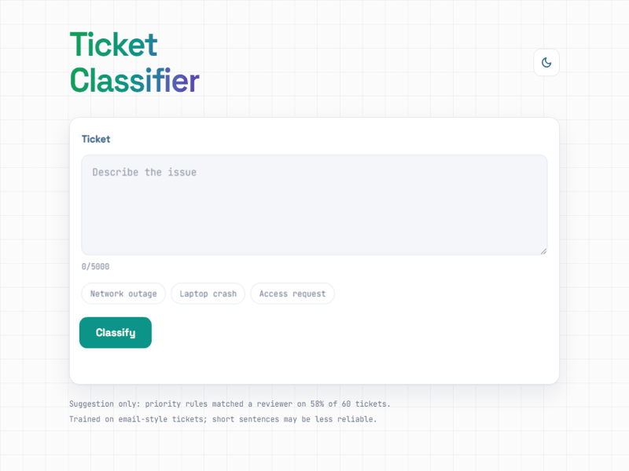

## Problem and scope

This project classifies free-text IT help desk tickets into eight `Topic_group`
categories using the `Document` column, then adds a transparent High/Medium/Low
priority suggestion from the predicted category and urgency wording.

The dataset contains 47,837 processed email-style tickets. Its original source
and licence are not recorded, so the data is not relicensed under this
repository's MIT licence.

### Explicit non-goals and limitations

- This is not an auto-routing system without human oversight.
- Priority is a separate rule layer, not a trained priority model.
- The data comes from one help desk and may not transfer to another organisation.
- Priority rules were only loosely validated on a 60-ticket human review sample.
- The model is not a security, compliance, SLA, or incident-severity decision-maker.
- Short handwritten sentences can be less reliable than the processed email-style
  tickets used for training.
- The model artefact is not retrained by the API.

## System flow

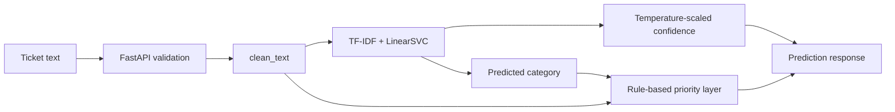

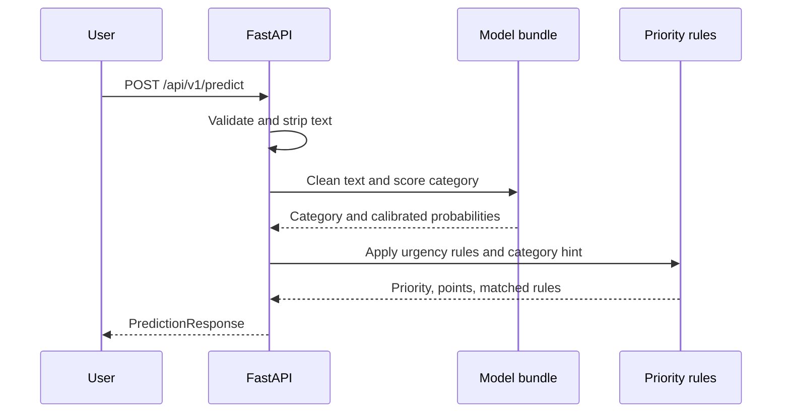

## Data and API fields

| API field | Source column or computation | Units | Valid range |
|---|---|---|---|
| `text` | `Document` | characters | 5-5,000 non-blank characters |
| `category` | `Topic_group` learned by the classifier | category name | One of 8 class names |
| `category_confidence` | Calibrated model score | probability | Greater than 0 and at most 1 |
| `top_categories` | Calibrated scores from `Document` | three category/probability pairs | Three ranked classes |
| `priority` | Predicted category plus urgency wording | level | `High`, `Medium`, or `Low` |
| `priority_points` | Sum of matched rule points and category hint | points | Integer |
| `priority_rules_matched` | Matched urgency rules in cleaned `Document` | rule names | Zero or more rule names |
| `priority_method` | Application metadata | text | `rule-based; not a trained model` |
| `status` | Application health state | text | `ok` or `degraded` |
| `model_loaded` | In-process model cache state | boolean | `true` or `false` |
| `results` | Batch of prediction results | list | 1-100 prediction objects |
| `model_name` | Model bundle metadata | text | `LinearSVC` |
| `hf_repo_id` | Model bundle deployment metadata | text | Hugging Face repository ID |
| `hf_revision` | Model bundle deployment metadata | tag | `v1` |
| `class_names` | Model bundle `classes` key | list of text | Eight trained class names |
| `temperature` | Model bundle calibration metadata | scalar | Positive floating-point value |
| `rules_version` | Priority rule definition | integer | `3` |
| `high_at` / `medium_at` | Priority thresholds | points | `4` / `2` |
| `library_versions` | Model bundle `versions` key | mapping | Recorded package versions |

## Dataset and class balance

| Category | Tickets | Share |
|---|---:|---:|
| Hardware | 13,617 | 28.47% |
| HR Support | 10,915 | 22.82% |
| Access | 7,125 | 14.89% |
| Miscellaneous | 7,060 | 14.76% |
| Storage | 2,777 | 5.81% |
| Purchase | 2,464 | 5.15% |
| Internal Project | 2,119 | 4.43% |
| Administrative rights | 1,760 | 3.68% |

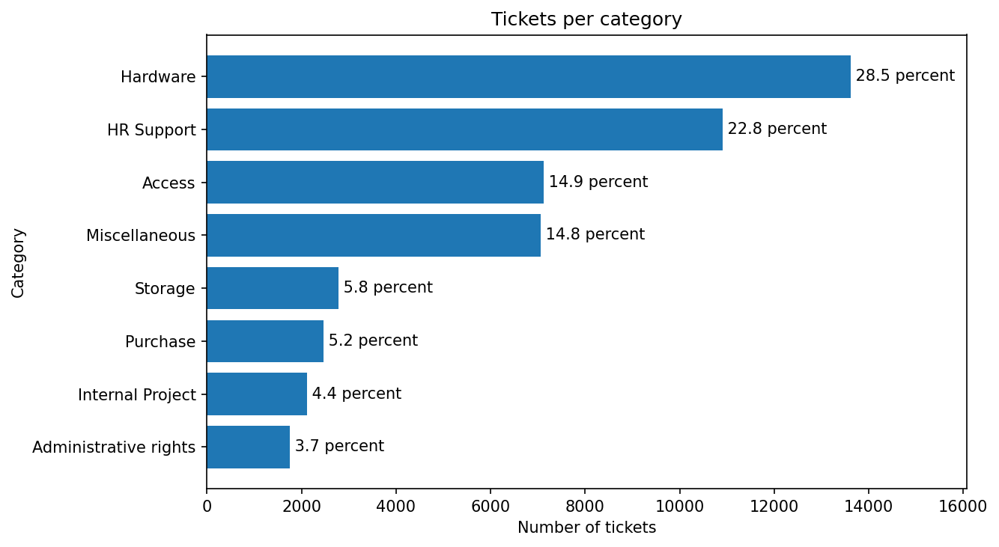
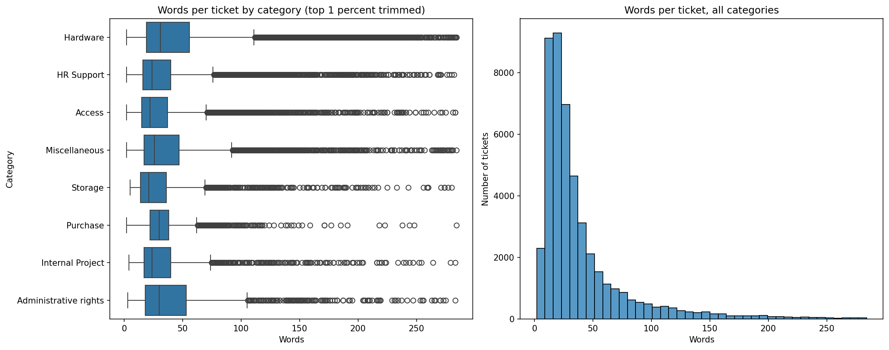

## Model

The exact artefact is `model/category_model.joblib`, a joblib dictionary
containing a TF-IDF pipeline and `LinearSVC(C=0.3)`, calibrated with temperature
scaling. The public Hugging Face location is
[`cyrusnx/it_ticket_classifier_linearsvc`](https://huggingface.co/cyrusnx/it_ticket_classifier_linearsvc)
at pinned revision `v1`.

The vectorizer uses English stop words, unigrams and bigrams, `min_df=3`,
`max_features=20,000`, and sublinear TF. The model uses balanced class weights.
No resampling is used because the fitted class weights handle the observed
imbalance.

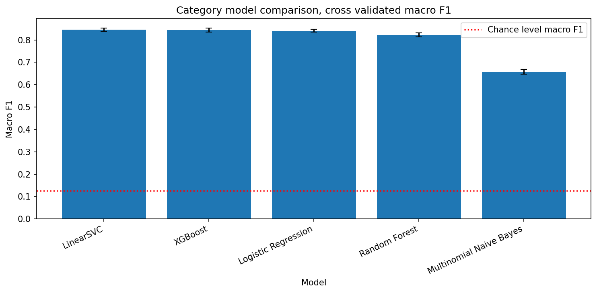

## Results

The final evaluation uses the held-out test set of 9,568 tickets.

| Scoring version | Accuracy | Macro F1 | Log loss | Calibration error | Mean confidence |
|---|---:|---:|---:|---:|---:|
| Raw softmax of scores | 0.855560 | 0.857525 | 0.895147 | 0.371611 | 0.483948 |
| Temperature scaled | 0.855560 | 0.857525 | 0.433073 | 0.025621 | 0.868025 |

| Category | Precision | Recall | F1 | Support |
|---|---:|---:|---:|---:|
| Access | 0.896 | 0.887 | 0.891 | 1,401 |
| Administrative rights | 0.737 | 0.812 | 0.773 | 356 |
| HR Support | 0.892 | 0.849 | 0.870 | 2,187 |
| Hardware | 0.846 | 0.821 | 0.833 | 2,726 |
| Internal Project | 0.811 | 0.914 | 0.860 | 432 |
| Miscellaneous | 0.797 | 0.854 | 0.825 | 1,370 |
| Purchase | 0.927 | 0.915 | 0.921 | 527 |
| Storage | 0.875 | 0.902 | 0.888 | 569 |

Administrative rights is the weakest class by F1 at 0.773.

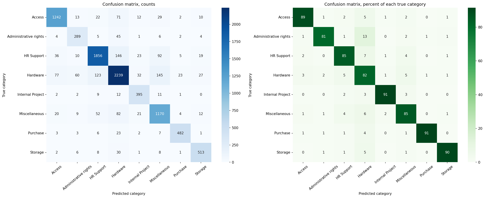
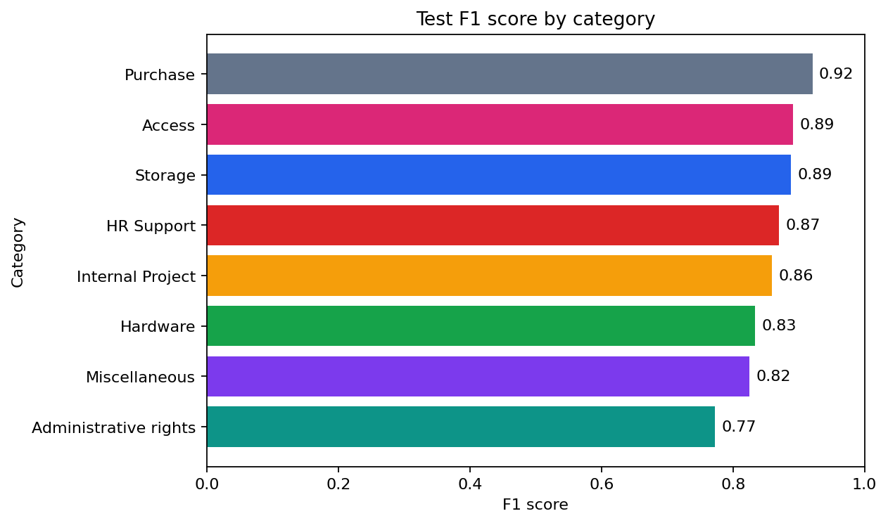

## Calibration and confidence coverage

Temperature scaling uses a fitted temperature of `0.277762`. It leaves the
predicted class unchanged while reducing calibration error from `0.371611` to
`0.025621`.

| Minimum confidence | Ticket coverage | Accuracy on covered tickets |
|---:|---:|---:|
| 0.5 | 92.21% | 88.88% |
| 0.6 | 86.43% | 90.98% |
| 0.7 | 80.81% | 92.69% |
| 0.8 | 74.06% | 94.45% |
| 0.9 | 65.15% | 96.20% |

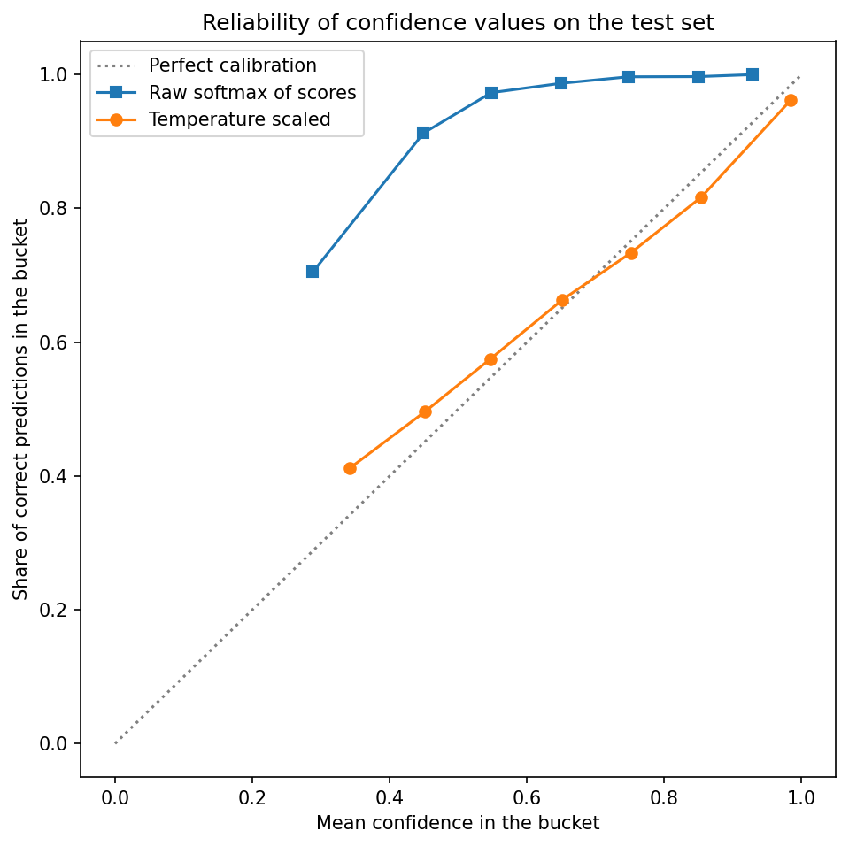
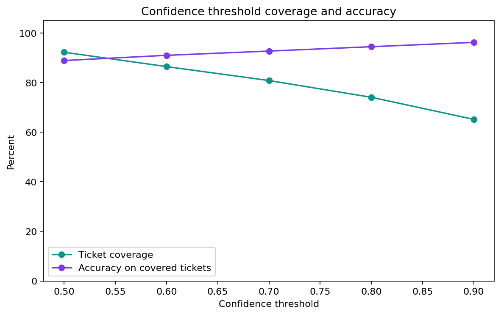

## Model terms

The model's weighted terms and the exploratory distinctive terms are shown
below. These are explanations of corpus and model signals, not causal evidence.

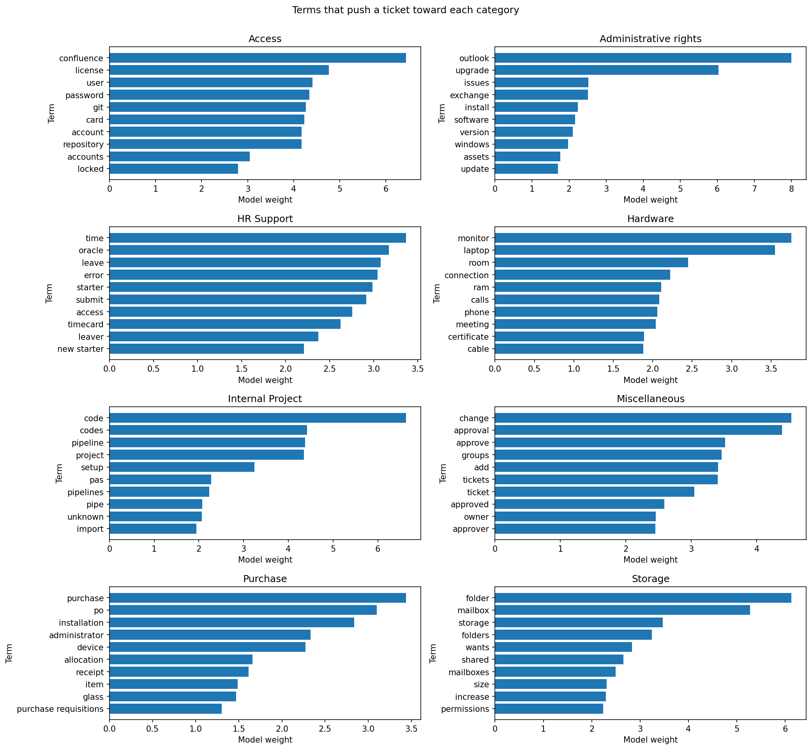
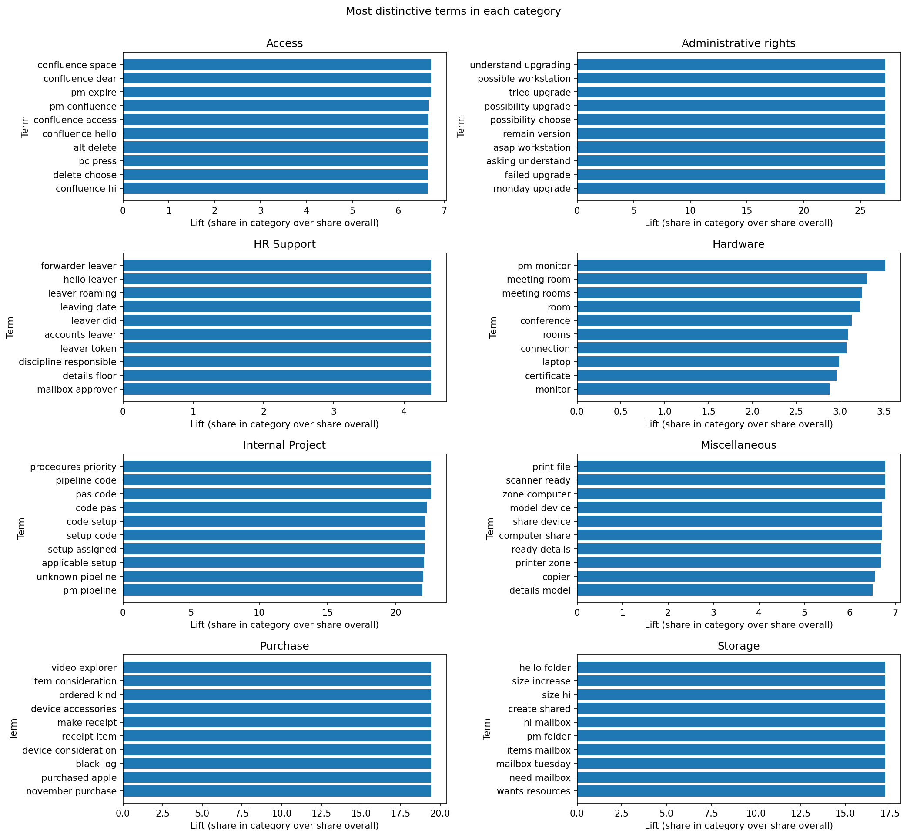

## Priority layer

Rules version 3 assigns points from urgency wording and a small category hint:

- High: `4` points or more.
- Medium: `2` or `3` points.
- Low: below `2` points.

The predicted priority mix is High `10.1%`, Medium `14.0%`, and Low `75.9%`.
No urgency rule matched `61.5%` of the evaluated tickets.

The rule layer's level changed in `1.9%` of held-out tickets when the true
category replaced the predicted category. Moving both thresholds up by one
point changed `10.8%` of levels; moving them down by one changed `44.7%`.

The 60-ticket human review found exact agreement of `0.58`, agreement within
one level of `0.88`, and `7` serious High-versus-Low misses. The rule predicted
High for `11` reviewed tickets and agreed with the reviewer on only `2` of
those `11`.

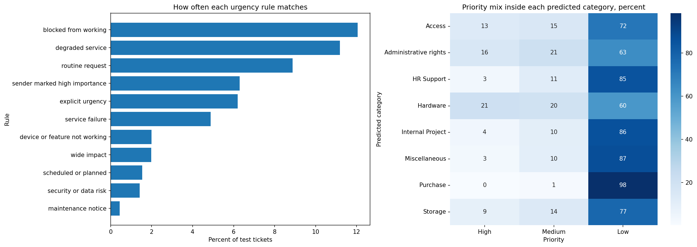
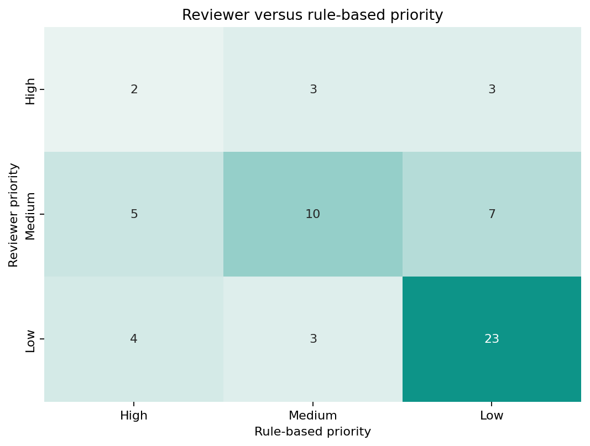

## User interface


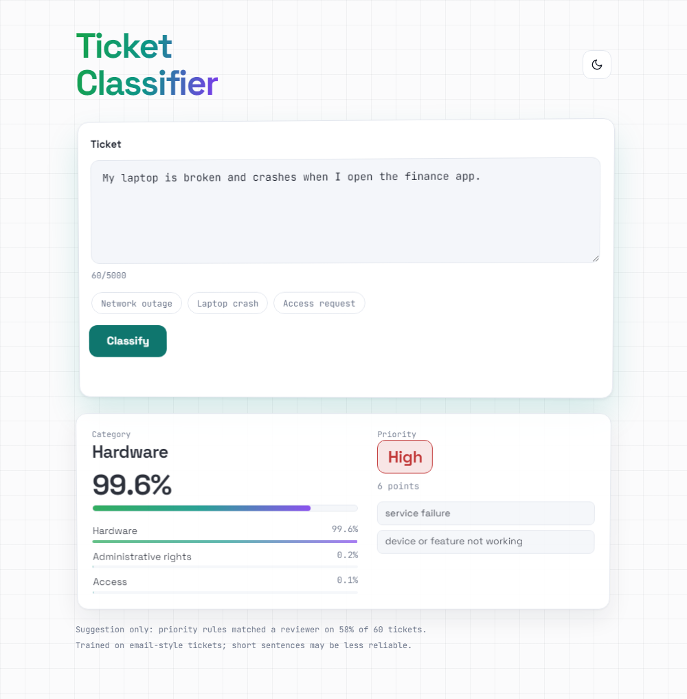
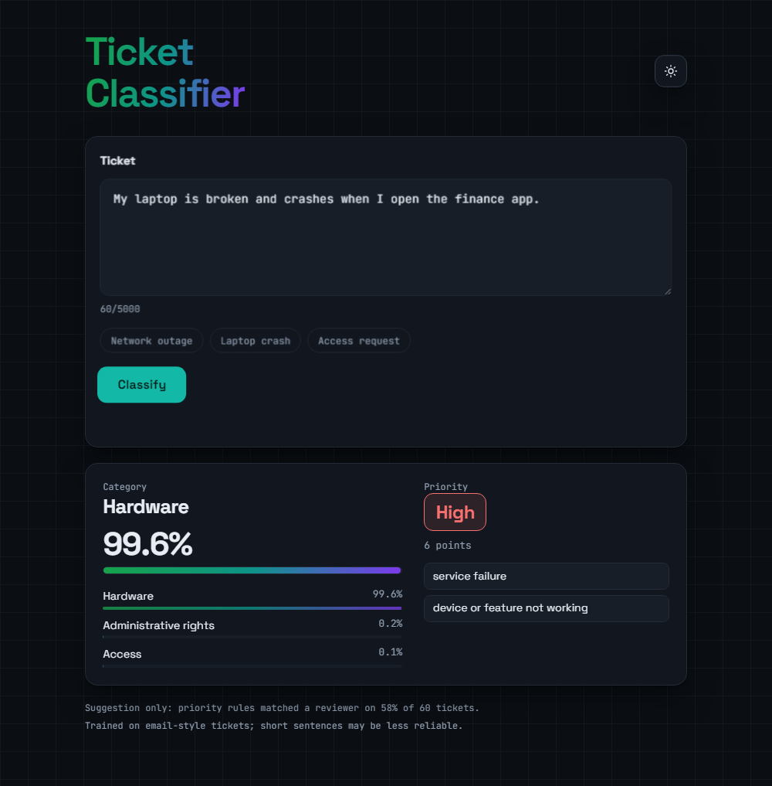
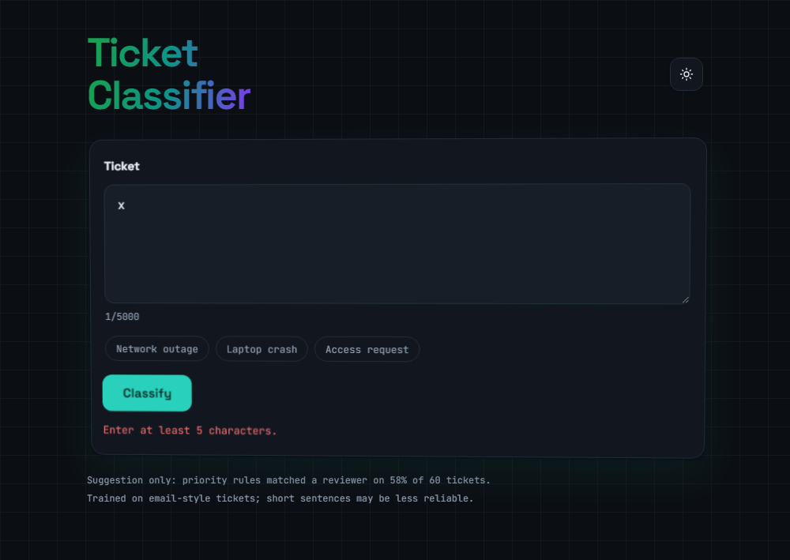

## API reference

All API routes are under `/api/v1`.

### `GET /health`

Request: no body.

Response:

```json
{
  "status": "ok",
  "model_loaded": true
}
```

### `POST /predict`

Request:

```json
{
  "text": "My laptop is broken and crashes urgently."
}
```

Response:

```json
{
  "category": "Hardware",
  "category_confidence": 0.96,
  "top_categories": [
    {"category": "Hardware", "probability": 0.96},
    {"category": "Purchase", "probability": 0.032},
    {"category": "Access", "probability": 0.003}
  ],
  "priority": "High",
  "priority_points": 5,
  "priority_rules_matched": ["service failure", "degraded service"],
  "priority_method": "rule-based; not a trained model"
}
```

### `POST /predict/batch`

Request:

```json
{
  "texts": [
    "My laptop is broken and crashes urgently.",
    "How do I request access to a shared folder?"
  ]
}
```

Response:

```json
{
  "results": [
    {
      "category": "Hardware",
      "category_confidence": 0.96,
      "top_categories": [],
      "priority": "High",
      "priority_points": 5,
      "priority_rules_matched": ["service failure", "degraded service"],
      "priority_method": "rule-based; not a trained model"
    }
  ]
}
```

The batch `results` entries have the same complete shape as the single
prediction response; `top_categories` is abbreviated above only to keep the
example short.

### `GET /model-info`

Request: no body.

Response:

```json
{
  "model_name": "LinearSVC",
  "hf_repo_id": "cyrusnx/it_ticket_classifier_linearsvc",
  "hf_revision": "v1",
  "class_names": [
    "Access", "Administrative rights", "HR Support", "Hardware",
    "Internal Project", "Miscellaneous", "Purchase", "Storage"
  ],
  "temperature": 0.277762,
  "rules_version": 3,
  "high_at": 4,
  "medium_at": 2,
  "library_versions": {
    "python": "3.13.16",
    "pandas": "2.3.3",
    "numpy": "2.1.3",
    "scikit_learn": "1.6.1",
    "xgboost": "3.4.1"
  }
}
```

The web root `GET /` serves the frontend. Invalid request bodies return HTTP
422. The batch endpoint accepts 1 to 100 items; each text must contain 5 to
5,000 non-blank characters.

### `GET /`

Returns the self-contained HTML application. Static browser assets are mounted
under `/static`.

## Project structure

```text
FUTURE_ML_02/
├── .github/
│   ├── dependabot.yml
│   └── workflows/ci.yml
├── apps/
│   ├── __init__.py
│   ├── main.py
│   ├── model_loader.py
│   ├── routes.py
│   └── schemas.py
├── database/
│   ├── db_connection.py
│   └── models.py
├── docs/images/
│   ├── calibration_category.png
│   ├── confidence_coverage.png
│   ├── confusion_category.png
│   ├── demo.gif
│   ├── eda_category_counts.png
│   ├── eda_text_length.png
│   ├── eda_top_terms_distinctive.png
│   ├── eda_top_terms_frequent.png
│   ├── model_comparison_category.png
│   ├── per_class_f1.png
│   ├── priority_review_agreement.png
│   ├── priority_rules_overview.png
│   ├── top_terms_model_category.png
│   ├── ui_empty.png
│   ├── ui_error.png
│   ├── ui_result_dark.png
│   └── ui_result_light.png
├── frontend/index.html
├── machine_learning/
│   ├── __init__.py
│   └── machine_learning.py
├── model/category_model.joblib
├── notebooks/it_support_ticket_classification.ipynb
├── outputs/
│   ├── classification_report.csv
│   ├── confidence_coverage.csv
│   ├── confidence_reliability.csv
│   ├── model_comparison_category.csv
│   ├── priority_review_guide.txt
│   ├── priority_review_sample.csv
│   ├── priority_rules.json
│   ├── run_summary.json
│   └── test_metrics.csv
├── raw_data/
│   ├── all_tickets_processed_improved_v3.csv
│   └── clean/tickets_clean.csv
├── scripts/
│   ├── capture_ui.py
│   ├── clean.py
│   ├── ingest.py
│   ├── load.py
│   ├── make_figures.py
│   ├── requirements.txt
│   ├── test_connection.py
│   └── upload_model.py
├── tests/
│   ├── test_api.py
│   ├── test_hf_download.py
│   └── test_machine_learning.py
├── .dockerignore
├── docker-compose.yml
├── Dockerfile
├── LICENSE
├── pyproject.toml
├── requirements.txt
└── requirements_dev.txt
```

## Quick start

### Local Python

```powershell
py -3.13 -m venv .venv
.venv\Scripts\Activate.ps1
python -m pip install -r requirements_dev.txt
uvicorn apps.main:app --reload
```

Open <http://127.0.0.1:8000/>.

### Docker

```powershell
docker build -t it-ticket-classification .
docker run --rm -p 8000:8000 it-ticket-classification
```

The Docker build downloads the pinned public model revision and fails if the
artefact cannot be loaded.

## Configuration

| Variable | Purpose | Required |
|---|---|---|
| `DATABASE_URL` | PostgreSQL connection string for database scripts | Only for database scripts |
| `HF_TOKEN` | Hugging Face upload authentication | Only for `scripts/upload_model.py` |
| `CORS_ORIGINS` | Comma-separated browser origins | No; local origins are the default |
| `PORT` | HTTP port used by the container | No; defaults to `8000` |
| `HF_HOME` | Hugging Face cache directory | No; set by Docker |

Never commit `.env`. The public model download and inference paths do not
require `HF_TOKEN`.

## Testing and CI/CD

Run the local checks with:

```powershell
ruff check .
pytest -q
```

The Hugging Face integration test is marked `hf` and is deselected by default.
CI downloads the public `v1` model, runs Ruff and pytest on Python 3.13, builds
the Docker image, and deploys only successful pushes to `main`. Deployment
pushes the lowercased repository image name to GHCR, triggers the Render deploy
hook, and waits for `/api/v1/health` to report `model_loaded: true`.

Figures from the original notebook are preserved in `docs/images`. The
evaluation figures `per_class_f1.png`, `confidence_coverage.png`, and
`priority_review_agreement.png` come from
[`scripts/make_figures.py`](scripts/make_figures.py). The UI screenshots and
`demo.gif` come from [`scripts/capture_ui.py`](scripts/capture_ui.py).

## Author and licence

Created by **Cyrus Ndung'u** ([Cyrusz55](https://github.com/Cyrusz55)).
The code is licensed under the [MIT Licence](LICENSE). The dataset's original
source and licence were not recorded and the dataset is not covered by the MIT
licence.
